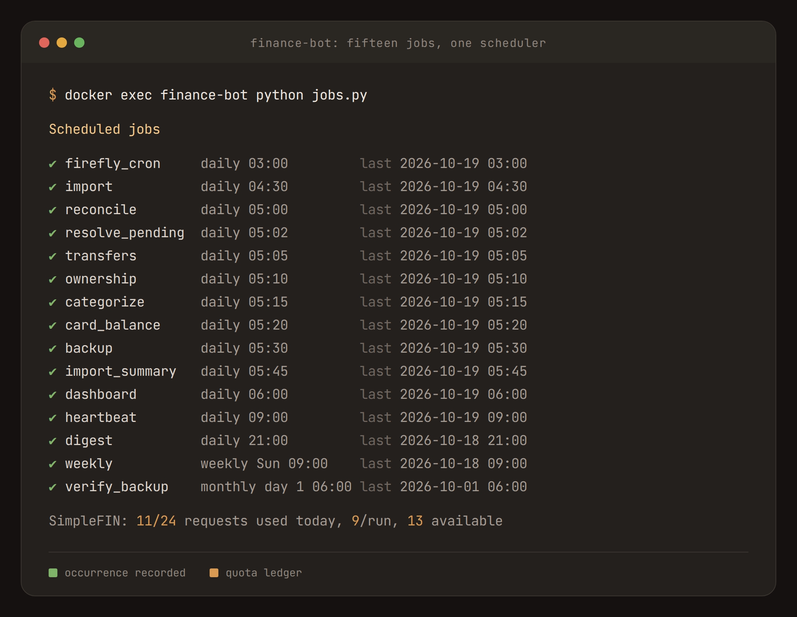
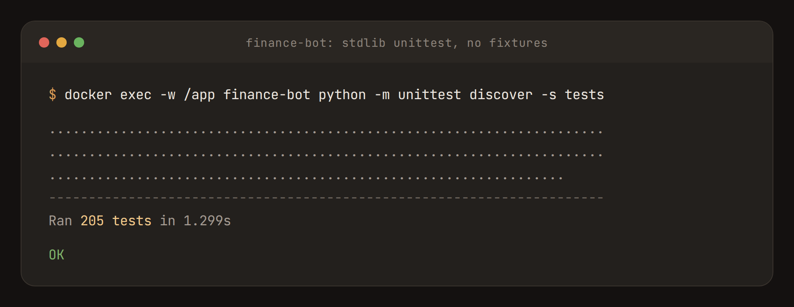

import Diagram from "../../../components/Diagram.astro";

**finance-bot** automates the [Firefly III](https://www.firefly-iii.org/) ledger my partner and I share. It imports our bank transactions every morning, categorises them, and answers questions in Telegram. It's about 6,000 lines of stdlib-only Python and runs on [my home server](/homelab/).

<Diagram variant="grid" title="What it does">

- **Imports.** Every account syncs overnight through SimpleFIN.
- **Categorises.** Rules handle about 97%; a model handles the rest, and anything uncertain becomes a question.
- **Splits shared spending.** Tags each transaction as mine, my partner's or shared, and works out the card split.
- **Tracks budgets and bills.** Burn-down per category, a month-end projection, and upcoming bills.
- **Builds a dashboard.** A household page rebuilt every morning.
- **Answers in chat.** Net worth, spending and budgets, from Telegram.

</Diagram>

## The Nightly Schedule

<Diagram title="Every morning">

- **04:30, Import.** New transactions from every account.
- **05:00, Reconcile.** Card payments, cleared holds and transfers between us matched up; owners tagged.
- **05:15, Categorise.** Rules first, then a model for the rest.
- **05:30, Back up.** The whole ledger, to the file share.
- **06:00, Dashboard.** Rebuilt from the morning's data.
- **21:00, Digest.** Yesterday's spending and the month's pace.

</Diagram>

## Shared Expenses

My partner's accounts are in the same ledger. Each transaction gets an owner tag based on its account and category (rent and utilities are always shared), and `/card` splits the shared card bill by what each of us actually spent, minus what we already paid directly. Zelle transfers between us are merged into a single transfer and counted as a settlement.

## Chat

Everything happens in Telegram: status, budgets, bills, net worth, spending search, the card split and the dashboard link. When something can't be categorised, it shows up as a numbered question and I answer in plain English:

> *"2 is my car insurance, 3 and 4 are food"*

The bot proposes the change with Apply and Cancel buttons and writes nothing until I tap. Answers turn into rules, so the same merchant isn't asked about twice.

For browsing the ledger itself I use Abacus, an open-source iOS client for Firefly III.

## Dashboard

Every morning it generates a static page with the month's data embedded, so it can be filtered by month, person, category or day right in the browser. It's built from the same code as the chat reports, so the numbers always match.

## Reliability

<Diagram variant="grid" title="Built to run unattended">

- **A scheduler with memory.** Restarts don't double-run jobs, and missed runs catch up.
- **Quota tracking.** Stays within SimpleFIN's 24 requests a day.
- **Undo.** Every automatic change can be reversed from chat.
- **Tested backups.** Nightly backups, with a monthly restore test.
- **205 tests.** Plain `unittest`, no dependencies.

</Diagram>

It runs on my own hardware, so our financial data never leaves the house.
