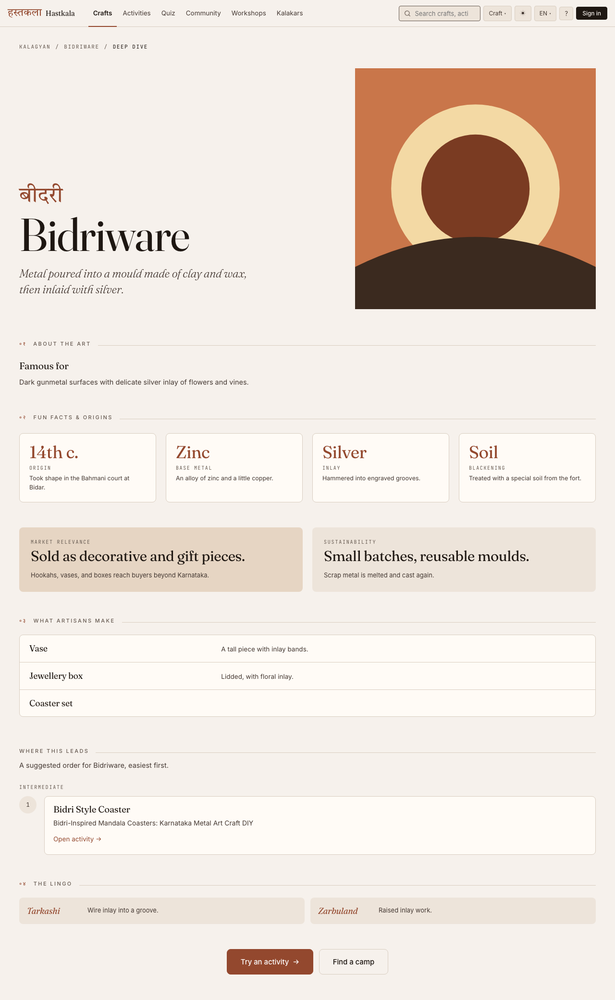
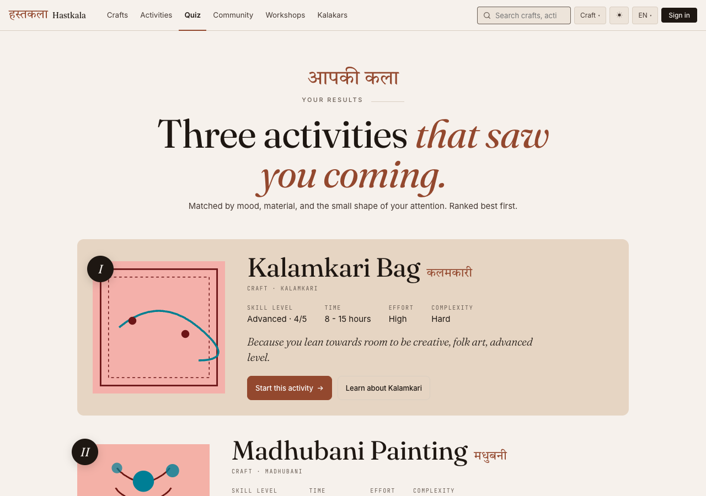

import Diagram from "../../../components/Diagram.astro";

Hastkala (हस्तकला, "handicraft") is a living archive and a learning companion for Indian handicrafts. You read about a craft, find out which one suits you, and then make something yourself, step by step.

It covers 36 crafts and 86 activities in English and Hindi, and it lists the artisans, the **kalakars**, who make these things and the workshops they teach.

<Diagram variant="grid" title="What it does">

- **Craft catalogue.** 36 crafts with history, key features and a deep dive each, browsable on a map of India.
- **Step-by-step activities.** 86 projects with materials, steps and safety notes, and progress you can tick off.
- **Hobby Finder quiz.** Seven questions, then three activities that suit your mood, patience and budget.
- **Workshops.** Kalakars publish sessions with limited seats, and visitors book one with a click.
- **Kalakar profiles.** Artisan pages with reviews and upcoming workshops, approved before they go public.
- **Community.** Questions, answers and progress photos on craft and activity pages.
- **English and Hindi.** The interface and the craft content, in both.

</Diagram>

## Who Made This

Hastkala is not my idea, and I want that to be unambiguous.

**Asritha Nagubandi, Poornima Chaturvedula and Jayneel** are the subject matter experts. The idea is theirs. So are the requirements gathering, the design direction, every feature decision and the craft data. Their requirements became a board of 55 stories.

I joined because I was interested. I did the **architecture, the feature development and the infrastructure**, and I deployed it. They did not write the code, and I did not make the product decisions. When I had an opinion about scope, I wrote it down for them to decide.

## No Server, On Purpose

The app is a React single-page app that talks straight to Supabase. There is no API server in between. The browser reads and writes Postgres directly, and **row-level security** decides what each person can see and change. Visitors only receive published rows. Drafts, registrations and notifications are protected by policy.

That is a real tradeoff. Authorization lives in SQL, so a mistake there is a data leak rather than a bug in one screen. It is also much less code to get wrong.

The goal was $0 per month, and the backend choice came from that. The data is relational: crafts have activities, kalakars have workshops with seat limits, reviews roll up into ratings. Postgres does that in plain SQL. Firebase's free plan could not do half of what the board asked for, because photo storage and server functions both need the paid plan, which has alerts but no hard spending cap. Supabase's free plan throttles instead of billing.

So Supabase holds 38 tables across 23 migrations, auth, storage, five Edge Functions and scheduled jobs. Firebase Hosting delivers the app. It all runs on free tiers. The honest later cost is about $26 a month, once real traffic needs it.

## Pages A Search Engine Can Read

A single-page app ships an empty `div` and fills it with JavaScript. Search engines handle that badly,.

So the build runs a prerender step after Vite. It writes static HTML for **125 pages**: 36 crafts, 86 activities, the home page and two index pages. It also writes a sitemap, adds Open Graph tags, and seeds the query cache into each page so the client does not flash a loading state. This is static markup that the client render replaces, not server rendering with hydration. The build fails if Supabase is configured but unreachable, so a deploy cannot quietly publish empty pages.

Prerendering only helps if the page is also light, so I set a budget of **170 kB of gzipped JavaScript**. React, Supabase, the router, the query client and i18n alone come to about 182 kB, so holding it takes work. The realtime client is aliased to a stub, because the app polls and never opens a channel. The storage client loads only when someone uploads. A version guard falls back to the full clients, with a warning, if the installed Supabase packages differ from the version the stubs were written for. The Markdown parser, about 36 kB, loads only for content that uses Markdown, and the community and workshop sections mount when they scroll near the viewport.

Measured on 3 October, the initial payload is 162.6 kB on the home page, 167.4 kB on a craft and 169.4 kB on an activity. That is almost no headroom.

The other number I cared about is layout shift. The font swap was moving the activity page by **0.206**. Giving each web font a metric-matched fallback, so the fallback takes the same space as the real font, brought it to **0.003**.

## The Parts That Had To Be Right

Most of Hastkala is reading and filtering. A few parts are not allowed to be approximately right.

**Workshop seats.** Two people must not take the last seat. Booking is one Postgres function that runs `select ... for update` on the workshop row, so concurrent bookings queue behind each other. It counts active registrations, then books or returns "full". Booking and its reminders are built. I have not exercised them with real bookings.

**Search that forgives you.** One SQL function ranks crafts, activities and approved artisans in tiers: exact, whole word, prefix, substring. Fuzzy trigram matching only counts per word, above a similarity of 0.5. That is why "madhubni" still finds Madhubani while "cheriyal" no longer pulls up an unrelated weaving activity. Hindi names are searched too.

**Notifications as an outbox.** When something happens, such as an answer to your question or a cancelled workshop, a trigger writes the in-app notification and an outbox row in the same transaction, so nothing sends a message for an event that did not commit.

<Diagram title="From an event to a delivery">

- **A trigger writes the row.** The in-app notification and, per preferences, an outbox row.
- **pg_cron fires every five minutes.** It calls the send function through pg_net, with a secret from the vault.
- **A batch is claimed.** Due rows are locked with `skip locked`, so two runs never send the same one.
- **Push goes out.** Through Firebase Cloud Messaging.
- **Failures back off.** The wait doubles each time, and after five attempts the row is marked failed and appears in the admin console.

</Diagram>

Email sending is switched off until the project has its own domain. Push is built and scheduled, but I have not yet seen it arrive on a real device.

**A quiz that never makes you wait.** The Hobby Finder asks seven questions from a pool of 24. Each answer maps to tags from a fixed vocabulary, and scoring is plain deterministic code that matches your tags against each activity's and returns the top three. A model only phrases questions. It never scores anything. Generating a new set takes five to eight seconds, so the Edge Function returns a stored set at once and generates the next one in the background, saved as a candidate for an admin to promote.

## Two Languages, Three Themes

Every string in the interface goes through i18next, about 1,040 keys per language, with identical key sets in English and Hindi. Hindi loads on demand. Craft and activity content has its own translation tables, with English as the fallback.

It is not complete. Activity steps and materials are English only, and so are the quiz pool questions.

There are three themes, museum, folk and craft, each in light and dark, so six variants of every screen.

For accessibility I ran an automated axe-core audit over 21 guest routes in all six variants. It started at 553 violating nodes and ended at zero. The fixes were a skip link, landmarks, focus on route change, labelled dialogs, a keyboard alternative to the map, reduced motion and AA contrast. That is an automated audit. I have not tried a real screen reader, and I would not call the app accessible on the strength of a tool.

## An Admin Console For The People Who Know The Crafts

The experts know these crafts, so I should not be the one editing the text. The app includes its own CMS, lazy-loaded so visitors never download it, and gated by role.

Editors get Markdown editors with preview, a Hindi tab, status filters and bulk publish. Every edit to a craft snapshots the previous row through a trigger, so there is a version history and any version can be restored. Kalakar applications wait in an approval queue, and reported posts go to a moderation queue with an audit log.

Publishing is what makes the static pages stale, so there is a **Rebuild static pages** button.

<Diagram title="From publish to live">

- **An editor publishes.** The change is in the database at once.
- **They press Rebuild.** An Edge Function checks they are staff, then sends a dispatch to GitHub.
- **CI builds.** The full build and prerender run against the live data.
- **Firebase deploys.** The static pages now match what was published.

</Diagram>

The button is built and the function is deployed, but I have not seen a full run go through.

## Built By A Small Fleet Of Agents

I built this with coding agents, and I count that as a feature of how it was made. A coordinator agent splits the work, worker agents each take a piece, and I am the architect and the reviewer. I write the constraints, review the diffs and decide what merges.

The same goes for content. The craft and activity text, in English and Hindi, was **drafted by AI**: 36 crafts and 86 published activities. It is a first draft, and it is waiting for the experts to review it. The admin console is where they will fix it.

The images were generated too. All **122 cover images**, one per craft and activity, came out of ComfyUI on [my home server](/homelab/), at no usage cost. Three seeds were reviewed per slot, and each image is stored with its seed, prompt and alt text in both languages.

## Running It For Free

Six GitHub Actions workflows run the operation: deploy on merge, preview channels for pull requests, database migrations on merge, a keep-alive query every three days because the free database pauses after seven idle days, a nightly encrypted backup kept for 14 days, and the rebuild behind the admin button. The actions are pinned to commit hashes, and the browser only ever gets the publishable key.

The site ships a strict content security policy, scripts from its own origin only and no framing. A dedicated security round on the database moved the access-policy helpers into a private schema, revoked execute rights from public roles, stopped clients changing their own approval status or suspension, and added length and HTTPS-only checks on profile fields.

## What I Took From It

The most useful part was working inside someone else's idea. My job was to make it cheap to run and hard to break, so the experts can keep changing it without me.

Row-level security rewards you for treating the database as the product. Seats, search, notifications and the audit trail ended up as a few well-placed pieces of SQL rather than application code, and I trust them more for it.

I also learned how much of the work is saying what is not done. Booking, push delivery, community posting and the rebuild button are built, and I have not seen them run in production. The content is a draft until the team reads it. Saying that plainly is more useful than a longer list of things that work.
