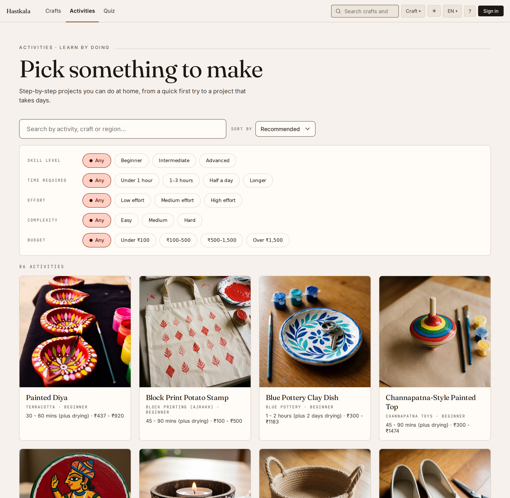
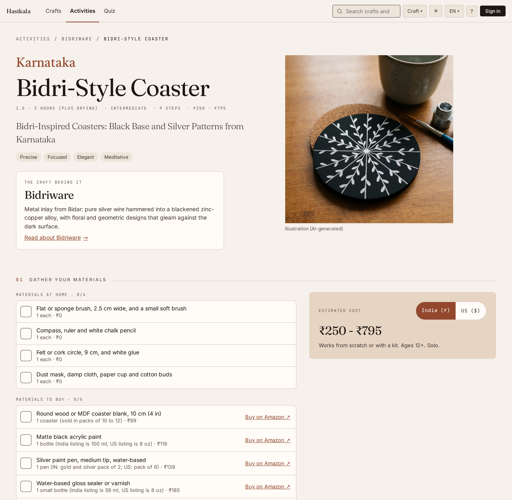
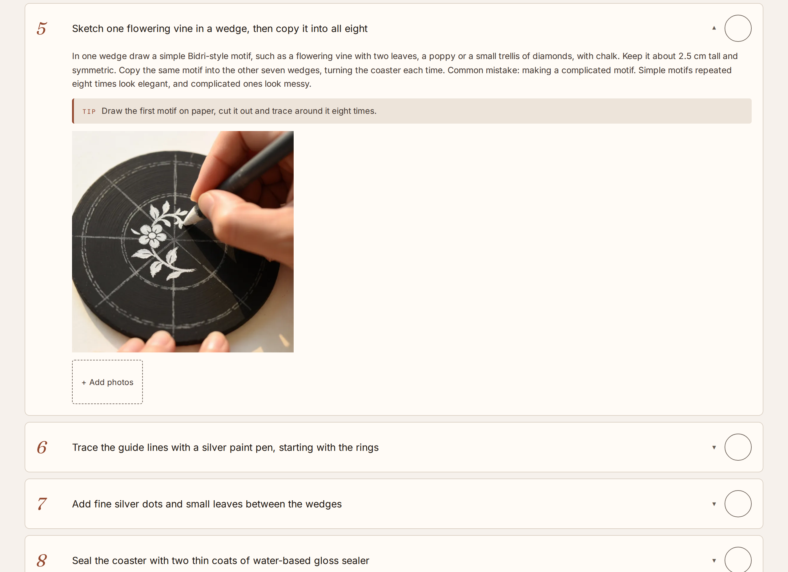
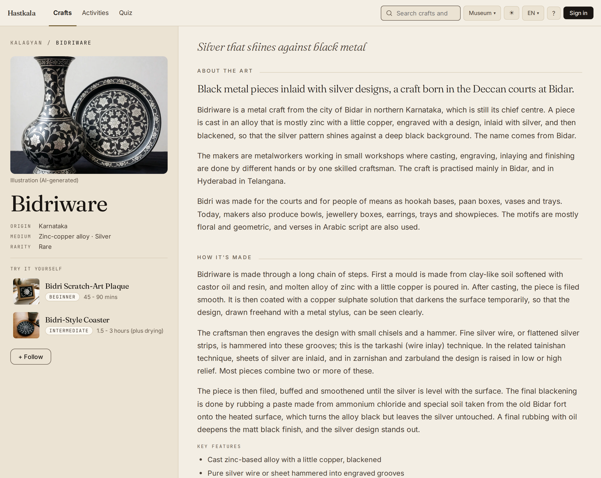
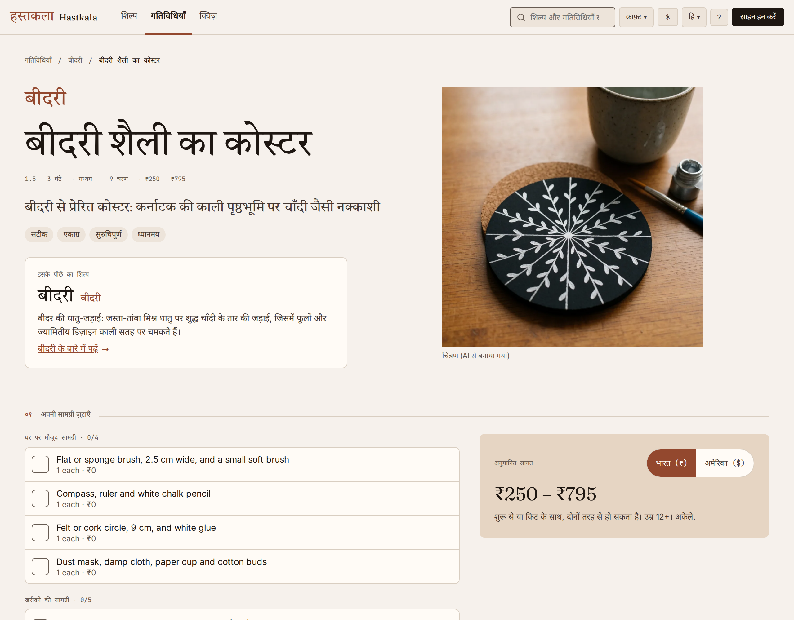
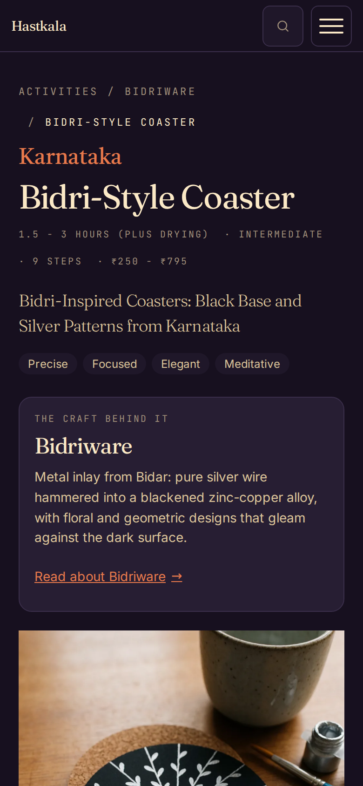

import Diagram from "../../../components/Diagram.astro";

Hastkala (हस्तकला, "handicraft") helps people discover Indian handicrafts and try them at home. You read about a craft, take a short quiz to find one that suits you, and follow a step-by-step activity to make something yourself.

<Diagram variant="grid" title="What it does">

- **Crafts.** 36 crafts with their history and how they're made, filterable by state, material and popularity.
- **Activities.** 86 projects you can do at home, filterable by skill, time, effort and budget.
- **Steps with pictures.** Each activity has steps, tips, a materials list with prices and buy links for India or the US, and videos.
- **Hobby Finder.** Seven quick questions, then three activities to start with.
- **English and Hindi.** Switch languages at any time.
- **Three themes.** Museum, folk and craft, each in light and dark.

</Diagram>

## Team

- **Asritha Nagubandi, Poornima Chaturvedula and Jayneel**: subject matter experts. Idea, requirements, design direction and craft knowledge.
- **Keshav Lingala**: development. Architecture, features and infrastructure.

## Activities

## Crafts

## Languages And Themes

## How It's Built

It's a React and TypeScript app, with Supabase for the database, sign-in and storage, hosted on Firebase. Pages are prerendered, so they load fast and show up in search, and it runs on free tiers.

The craft and activity text was drafted with AI and is being reviewed by the experts, who edit it in the app's own admin console. Cover images and step pictures were generated with ComfyUI on [my home server](/homelab/) and are labelled as AI-generated on the site. Inspiration photos are credited where they appear.

## What's Next

Community posts, workshop booking and artisan profiles are built but hidden until they're ready to launch.
