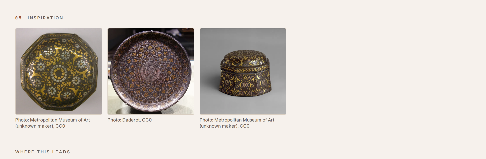
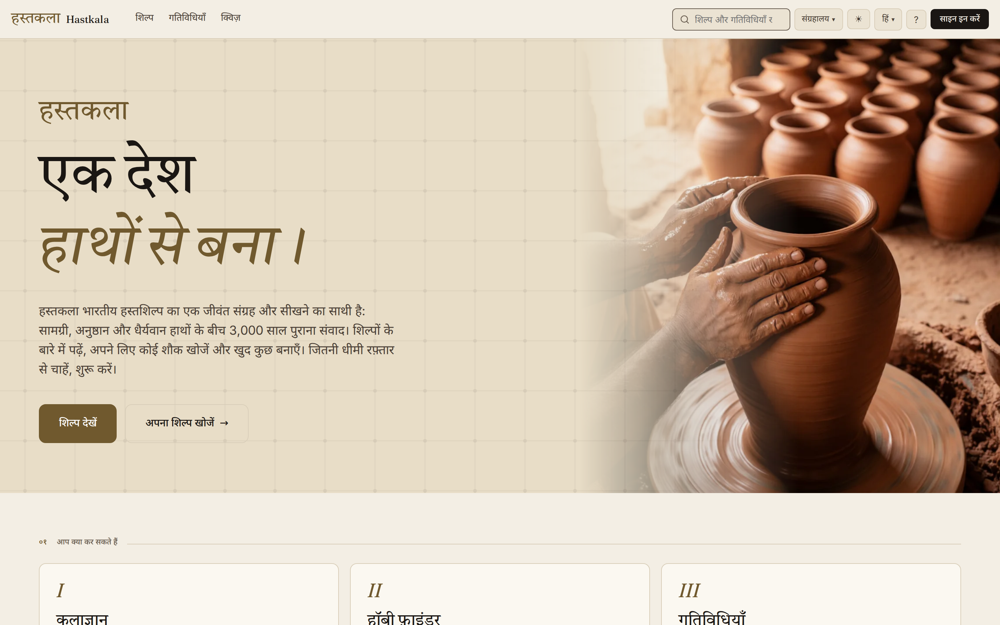
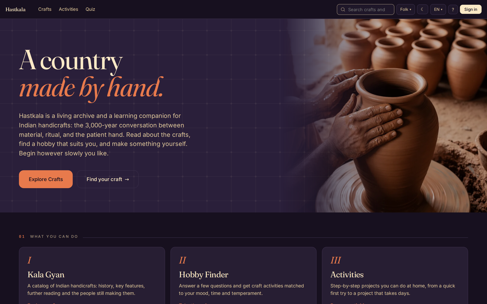
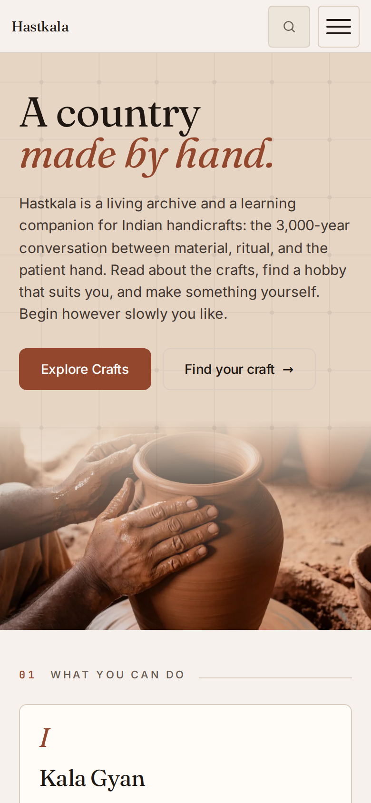

import Diagram from "../../../components/Diagram.astro";

Hastkala (हस्तकला, "handicraft") helps people discover Indian handicrafts and try them at home. You read about a craft, take a short quiz to find one that suits you, and follow a step-by-step activity to make something yourself.

It has 36 crafts and 86 activities, in English and Hindi.

<Diagram variant="grid" title="What it does">

- **Crafts.** 36 crafts with their history and how they're made, browsable on a map of India.
- **Activities.** 86 projects with steps, a materials list with prices and buy links for India or the US, videos and inspiration photos.
- **Hobby Finder.** A short quiz that suggests three activities to start with.
- **Search.** Forgiving search across crafts and activities, in both languages.
- **English and Hindi.** The interface and the content.
- **Three themes.** Museum, folk and craft, each in light and dark.

</Diagram>

## Who Made It

The idea is not mine. **Asritha Nagubandi, Poornima Chaturvedula and Jayneel** are the subject matter experts: the idea, the requirements, the design direction and the craft knowledge are theirs. I built the app, covering the architecture, the features and the infrastructure.

## How It's Built

It's a React app that talks directly to Supabase (Postgres, auth, storage and edge functions), with no server of my own in between. Row-level security in Postgres decides what each person can read and write. Firebase Hosting serves the site, and everything runs on free tiers.

Every craft and activity page is prerendered to static HTML at build time, so search engines can read it and the first load is fast.

## Content And Images

The craft and activity text was drafted with AI in English and Hindi, and is waiting on the experts' review. They can edit it in an admin console built into the app.

Cover images and step pictures were generated with ComfyUI on [my home server](/homelab/), and the site labels them as AI-generated. Inspiration pictures are mostly photos from Wikimedia Commons, credited on the page.

## Languages And Themes

Every string in the interface is translated, and craft content has its own translations with English as the fallback. The Hindi is machine-written for now and waiting for a native speaker's read.

## Built With Agents

I built it with coding agents: a coordinator agent splits the work, worker agents each take a piece, and I review the changes and decide what merges.

## What's Next

Community posts, workshop booking and artisan profiles are built but hidden until they're ready to launch.
