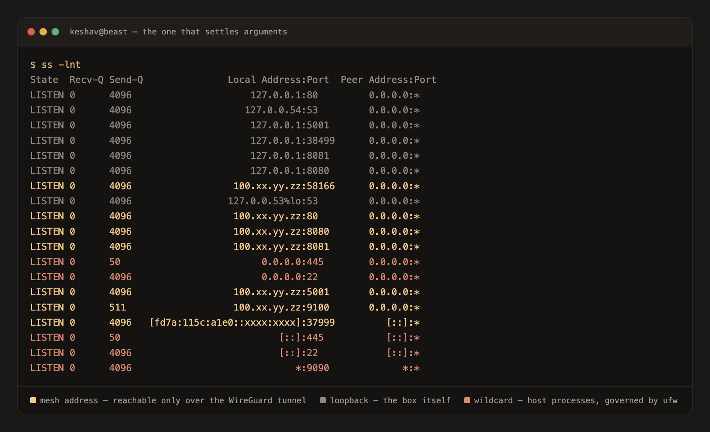

import Diagram from "../../../components/Diagram.astro";

I have an idea over breakfast. I open a web UI on my phone, paste a Compose file into it, and hit deploy. Ninety seconds later the thing is running on its own HTTPS hostname with a valid certificate, reachable from anywhere in the world, and I finish my coffee.

No AWS account. No instance to size. No VPC, no security group, no load balancer, no certificate to provision, no meter running. **beast** is a machine I built and put in the corner of my apartment, and it has quietly replaced every reason I used to have for renting someone else's computer.


<Diagram variant="grid" title="What it actually does">

- **Runs AI locally.** Open-source models served on my own GPU, behind an OpenAI-shaped API.
- **Generates images and video.** Through studio, an app I built that lets a chat model drive ComfyUI on 16 GB of VRAM.
- **Hosts coding agents.** Agent sessions live on the box, so I can start one on my laptop and pick it up on my phone.
- **Runs my money.** A self-hosted Firefly III ledger and [the automation around it](/finance-bot/).
- **Stores everything.** 1.7 TB mounted in Finder like any other drive.
- **Deploys in minutes.** Paste a config, hit a button, get a hostname.
- **Watches itself.** Intrusion alerts with a kill switch, and a network watchdog that repairs the link before I notice it's gone.
- **Blocks ads everywhere.** It's the DNS server for every device I own, at home or on cellular.

</Diagram>

## The Loop

The reason this changed how I build things is that the distance between "I want to try this" and "it is running on a URL" collapsed to almost nothing.

<Diagram title="Idea to running service">

- **Write a Compose file.** Or paste one from a project's README.
- **Drop it into the stack manager.** From a browser, on whatever device is in my hand.
- **Deploy.** Images pull, the container starts, and it's live on loopback.
- **Four lines in the proxy config.** One `handle` block and it has its own name, `https://<service>.beast.<my-domain>`. No DNS record, no certificate request, no port to pick.
- **Use it.** From my laptop, my phone, or a script, anywhere, on a real certificate.

</Diagram>

The same thing on a cloud provider is an account, an IAM policy, a VPC, a subnet, a security group, a load balancer, a certificate request, a DNS record, and a bill that starts the moment you click create and never stops. Here it is a file and a button, and the marginal cost of trying something is zero, so I try more things.

That last part matters more than it sounds. When spinning something up is free and instant, a bad idea costs an afternoon instead of a monthly line item, so I stop pre-judging which ideas are worth the setup. Most of what runs on this machine now started as something I was only half serious about.

## It Runs AI, And AI Runs It

This is the part that justified the GPU.

**Any open-source model, on demand.** I pull a model and it's serving on an API within minutes of deciding I want it. No approval, no quota, no per-token billing, no waiting for a provider to offer it. If a promising model drops, I can be testing it against my own workload from my phone before I've read the whole paper. It exposes an OpenAI-compatible API, so anything I write against it works unchanged, and there's a chat front end for when I just want to talk to it.

Nothing I type into it leaves the building.

**Image and video generation.** ComfyUI with the custom nodes and model weights that make a real image-to-video pipeline work inside 16 GB of VRAM. Generation runs for hours if it wants to; there's no clock running.

**Chaining models together, for free.** Because the language models and the image models live on the same box, connecting them costs nothing. That started as a small CLI, `imagine`, that had a local model expand a one-line idea into a full prompt and queue it on ComfyUI. It has since grown into **studio**, a web app I built and run here. I chat with a local model, or with Claude through the CLI on my own subscription, and it generates by tool call: text to image, image to video, animate, edit, upscale and refine, with a gallery and a job queue around it. Models cooperating in a pipeline I own end to end, with no API key and no per-call cost, so I could iterate on it until it worked instead of watching a bill grow while I debugged.

It was built the way most things on this box get built now: an agent on the machine acting as manager, dispatching worker agents against a phased design, with well over a thousand tests keeping them honest. The code is bind-mounted read-only into its container, so shipping a change is a restart, not a rebuild.

That is the shape of most things I build here now: a local model does the fuzzy part, ordinary code does the strict part, and the whole loop runs on hardware I already paid for.

**And it does the boring work too.** The finance system on this box uses a model to categorise the handful of transactions its rules don't recognise each night, validated against the real category list so it can't invent anything, and everything it writes is reversible. It runs at 05:15 whether or not I'm awake.

## Agents I Drive From My Phone

The machine hosts my coding agents, which is why the phone workflow stopped being a novelty and became how I actually work.

**Claude Code runs as a service on the box.** A user systemd unit keeps a `claude remote-control` server alive, with lingering enabled so it survives reboots and doesn't need me logged in. The Claude iOS app connects to it, so I can start a session on my laptop, close the lid, and continue the same session from my phone. The relay goes through Anthropic rather than my mesh, so it works from anywhere with signal, including places my VPN wouldn't help.

That means "update my portfolio" is a sentence I say to my phone. The agent has the repo checked out on the box, makes the change, and pushes it. I never open a laptop.

**SSH from anywhere, with no key to manage.** Mesh SSH means any iOS client, Termius or whatever else, reaches the box as me. Everything long-running lives in `tmux`, and one command, `cc`, attaches the persistent session or creates it if it's gone, so a cellular dropout costs nothing and "reconnect" and "start fresh" are the same thing. Admin from a train is the same experience as admin from my desk. Sessions do pile up, so the console lists every one on the box, shows me what's on its screen, and kills the stale ones.

<Diagram variant="grid" title="Three ways in, none of them exposed">

- **The stack manager.** Deploy and edit containers from a browser on any device.
- **Agent sessions.** Hosted on the box, resumable from the phone app, working against real repos.
- **A plain SSH client.** Persistent `tmux` sessions, so nothing dies when the connection does.

</Diagram>

## What Runs On It

Each stack is a folder with a Compose file, managed from the same web UI.

<Diagram variant="grid" title="The stacks">

- **Ollama.** Local model serving on the GPU. It evicts the model from VRAM after five idle minutes so the card is free for everything else.
- **ComfyUI.** Image and video generation, with the whole install on a bind mount so the container stays disposable.
- **studio.** My chat-to-generation app, reaching both of the above over their own Docker networks.
- **Open WebUI.** A plain chat front end for the local models, started when I want it.
- **Firefly III + Postgres.** The finance ledger and its bank importer. The database publishes no ports at all.
- **finance-bot.** The automation around the ledger, with [a write-up of its own](/finance-bot/).
- **caddy.** The reverse proxy every hostname goes through.
- **AdGuard Home.** DNS filtering for the whole tailnet.
- **homepage.** The front door: one nginx serving the live console and the finance dashboard behind one password.
- **Dockge.** The stack manager itself. Cockpit, for full system admin, runs on the host rather than in a container.

</Diagram>

Provisioning is a set of idempotent shell scripts that each verify their own prerequisites, so re-running any of them is safe. The Docker script refuses to start if the data volume isn't mounted or the driver isn't working, which means a half-finished install fails loudly at the right step rather than producing something subtly broken three steps later.

The later scripts cover the things that otherwise live only in some daemon's memory. The mesh's port bindings exist only in its own state, so one script is the written record of them: it reads the live config and re-applies whatever is missing. The services I wrote for the host itself run their test suites before they install, and don't install if those fail.

## Every Service Has Its Own Hostname

Every service has a name of its own, `https://<service>.beast.<my-domain>`, on a genuine, publicly trusted certificate that renews itself. It takes three pieces, and each one does a single job.

<Diagram title="One request, end to end">

- **Public DNS, private address.** `beast` and `*.beast` are ordinary records in Cloudflare pointing at the machine's address on my mesh. Anyone can look the name up; only my devices can reach what it points to.
- **A raw forward at the edge.** The mesh daemon owns ports 443 and 80 and passes the bytes through untouched to the proxy on loopback.
- **One proxy, one wildcard.** caddy ends TLS with a Let's Encrypt wildcard certificate issued over a DNS-01 challenge, and routes by hostname.
- **The service.** Which only ever listens on 127.0.0.1.

</Diagram>

Two details make it work. The certificate is a single wildcard, so the only name in the public certificate-transparency logs is `*.beast`, not a list of everything I run. And the proxy checks the DNS challenge against public resolvers, because the mesh's own DNS answers for its own names and can't see the challenge record.


| Service | Subdomain | What it is |
|---|---|---|
| Console | *(bare)* | Live status of everything below |
| studio | `studio` | Chat that drives image and video generation |
| Open WebUI | `openwebui` | Plain chat UI for the local models |
| Ollama | `ollama` | The model API itself |
| ComfyUI | `comfyui` | Image and video generation |
| Firefly III | `firefly` | The finance ledger |
| Importer | `importer` | Bank transaction importer |
| Dockge | `dockge` | Compose stack management |
| Cockpit | `cockpit` | Full system admin |
| AdGuard Home | `adguard` | DNS filtering for the tailnet |

Adding a service is a `handle` block and a proxy restart. No DNS change, no certificate, no new port on the mesh. The previous design gave every service its own HTTPS port on the mesh hostname, `:8443` for the ledger, `:3443` for chat and so on. Those bindings still answer, so nothing that bookmarked them broke.

Because the certificate is real, **native apps work**, not just browser tabs. I run Abacus, an open-source iOS client for Firefly III, pointed at my own ledger, with balances and charts as a proper app on my home screen. Mobile apps are far stricter about this than browsers: a browser lets you click past a self-signed certificate, an iOS app's networking stack simply refuses.


## The Front Door

The bare hostname used to be a page of links. It's now a live console: every container grouped by the Docker network it sits on, host CPU, memory, GPU and disk with a day of history, the finance jobs, and who's logged in, pushed to the page every two seconds while anyone is looking.


**It knows the difference between stopped and broken.** Liveness is a TCP connect from the box itself, so a service I stopped on purpose reads *stopped* and one that crashed reads *down*. The tile page it replaced checked reachability from the viewing browser, which proves the phone can reach a URL and says nothing about the service.

**It sees logins nothing else can.** The mesh daemon execs SSH sessions directly, bypassing PAM: no `auth.log` line, no utmp record, nothing in `who`. Cockpit, Netdata, Glances and Beszel all report zero users during an active session. The console reads the session helper's arguments out of `/proc`, which is the only record there is.

It's deliberately almost read-only. It runs unprivileged, so even if the front door were misconfigured it couldn't read other processes' environments, which is where the API keys live. Its one write is killing a tmux session, and that request has to carry the password, a JSON content type, a custom header and a matching origin, so a page on some other site can't fire it through my browser. The session that keeps the phone app connected is refused outright.

## Storage That Can't Wedge The OS

The Ubuntu installer leaves most of the volume group unallocated. A setup script carves that free space into a separate 1.7 TB data volume rather than growing root, so a runaway download or a 14 GB model file can never fill the OS disk.

That held for files. It didn't hold for container images, and it took a while to see why. Docker's `data-root` moved to the data volume on day one, but with the containerd image store, images and their snapshots don't live under `data-root` at all. They live under containerd's own root, configured separately, still on the OS disk. Every pull quietly ate root while `/var/lib/docker` sat nearly empty, so the obvious place to look said everything was fine. Root reached 77%. With containerd's root moved too, it's at 18%, and the hundred-odd gigabytes of images sit on the data volume where they always should have.


Two small scripts keep it that way: one sizes both roots, including what an unprivileged `du` can't see, and one reclaims the caches that are safe to drop.

The whole data volume is one Samba share tuned for Finder, which quietly removes a shell from several workflows: drop a model file in from my Mac and the running service picks it up immediately, and the finance system's nightly backups land somewhere I can drag off the machine.

## Private By Construction

Nothing is port-forwarded. There's no dynamic DNS and no exposed SSH. Every dashboard, the shell and the file share are reachable only over a WireGuard mesh where each device is individually authenticated. Even on my own home network, the firewall denies the dashboards.

The non-obvious part, and the thing most home-lab writeups get wrong, is that **Docker publishes ports below the host firewall.** Docker writes published ports into an iptables chain evaluated *before* `ufw`'s rules, so a container published as `"8080:8080"` is reachable from every machine on the LAN and `ufw deny 8080` does nothing about it. The firewall reports the rule. The port is open.

The first version of this machine handled that by binding every container explicitly, never the wildcard:

```yaml
ports:
  # v1: Docker bypasses ufw, so bind explicitly, never 0.0.0.0
  - "127.0.0.1:8080:8080"
  - "100.xx.yy.zz:8080:8080"
```



The TLS rewrite made it simpler, and the move to hostnames simpler again. Every container is loopback-only, the proxy is loopback-only too, and the only thing holding the mesh address for the web is the mesh daemon, forwarding two ports:

```yaml
ports:
  # loopback only. Docker never holds the mesh address; tailscaled forwards :443 to caddy.
  - "127.0.0.1:8080:8080"
```

So the list of things listening on a reachable address went from every container, to one proxy, to the mesh daemon plus one deliberate exception.

**The exception is DNS.** AdGuard Home is the nameserver for my whole tailnet, so every device I own gets ad and tracker blocking wherever it is, cellular included. DNS is UDP, which the mesh's serve feature can't forward, and publishing it through Docker would put it below the firewall again. So it runs on host networking and binds port 53 to exactly two addresses, the mesh address and its own LAN address, with `ufw` allowing the LAN side only from my home subnet. Its admin UI sits on loopback behind the proxy like everything else. I also tried making it the DNS server for the whole home router and backed that out, because browsing felt slower and the devices that matter already use it.

**And it's an exit node.** On hotel or airport wifi, my laptop and phone can send all their traffic out through my home connection instead, over the same encrypted mesh.

Host processes like `sshd` and Samba are a different category and really are governed by `ufw`. Knowing which of the two you're dealing with is the difference between a firewall rule that works and one that only looks like it does.

## It Watches Itself

A headless machine I only ever reach over the network has two failures worth automating against: someone else getting in, and me getting locked out.

**Intrusion alerts, tiered so I actually read them.** A small host service, `beast-sentry`, watches every way in: the journal (logins, `sudo`, Cockpit, Samba), the Docker event stream, pollers that diff system state, and Telegram itself. The real design work was the tiering. My own logins from known devices, Finder mounting the share and containers starting all go into a 09:00 digest. An unknown device on the tailnet, a new listening port, an unrecognised process on the GPU, a changed `authorized_keys` or a privileged container interrupts immediately. If routine activity pinged me, I'd learn to swipe alerts away, and the one that mattered would go unread with the rest.

The login sensor runs into the same oddity as the console: mesh SSH leaves no `auth.log` line, so the mesh daemon's own audit line is the primary sensor. The inverse is useful too. OpenSSH on this box has never once recorded a real login, so any successful one is a tripwire that needs no allowlist and no tuning.

Every critical alert carries a **power-off button**. It asks for a confirmation that expires in five minutes, nothing is ever automatic, and before halting it writes the alert to the file share so I can read what happened from my Mac after the box goes dark. Keeping it down is a firmware job rather than a software one: with restore-on-power and wake-on-LAN disabled, only the physical button brings it back. The sentry also installs to a root-owned directory instead of running off the share like everything else, because code on the share is editable by anyone holding the share's password, including whoever it's meant to be watching.

**A network that repairs itself.** The Wi-Fi 7 driver occasionally comes back from a reconnect associated, link up, every status tool green, and silently dropping every frame. On a headless box that's the failure that removes the means of fixing every other one. So a once-a-minute watchdog checks that the default route has an address and that something off-net answers, and climbs a ladder when it doesn't.

<Diagram title="The recovery ladder">

- **2 min, Renew.** Ask the network daemon for a fresh lease.
- **5 min, Supplicant.** Restart the Wi-Fi supplicant and the network daemon.
- **10 min, Reload.** Unload and reload the Wi-Fi driver, then re-apply the network config.
- **15 min, Mesh.** Restart the mesh daemon.
- **30 min, Reboot.** Budgeted: at most one every six hours, and three a day.

</Diagram>

A few rules keep the cure from being worse than the disease. When the router answers but the internet doesn't, the radio rungs are skipped, so an ISP outage doesn't become a local one. Each rung is recorded *before* it runs, because the top two destroy the watchdog's own network or the whole machine, and a reboot recorded afterwards would look untried and fire again on boot. And the driver's silent failure turned out to have exactly one observable: a kernel line logged once per dropped frame. More than 100 of those in two minutes skips straight to the reload, the only rung that clears it. During the incident that prompted all this, one two-minute window held 3,473 of them. A healthy window holds zero.

Alerting about a dead network can't depend on that network, so the watchdog pings a dead-man's switch on every healthy check and something outside the house raises the alarm when the pings stop. And after a routine library upgrade restarted the network units and took the radio down with them, those units were exempted from upgrade-triggered restarts.

## It Stays Mine

There's no monthly bill, no account that can be suspended, no model deprecated out from under me, no rate limit, and no terms of service governing what I'm allowed to run on my own hardware. The prompts, the transactions and the files never leave the building.

When it needs to be faster, I buy a part and put it in. That's the whole upgrade process. No instance type to migrate to, no reserved-capacity commitment, no quota request.

I'm honest that it isn't zero-dependency: the mesh has a coordination service, the certificates come from a public CA, the DNS records live with a provider, and a few integrations talk to APIs I don't run. But every one of those is commodity and replaceable, none of them holds my data, and none of them can raise a price on me. The tradeoff is that I'm my own operations team, and I'd make that trade again.

The box ships with a written operating guide aimed at whoever runs it rather than whoever built it, plus an instruction file at its root encoding the rules, so both humans and agents working on it inherit the constraints instead of rediscovering them.
