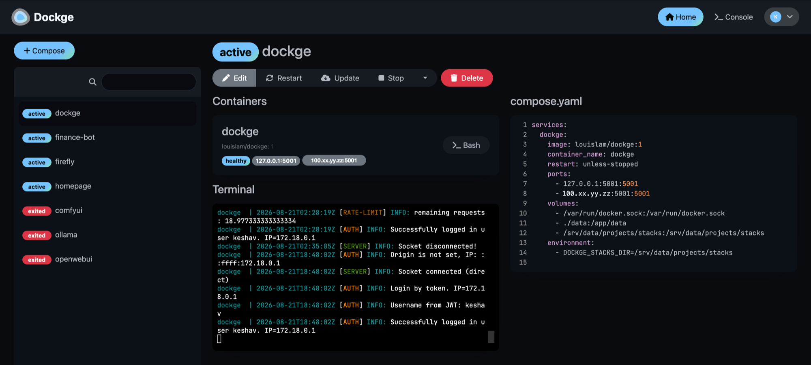
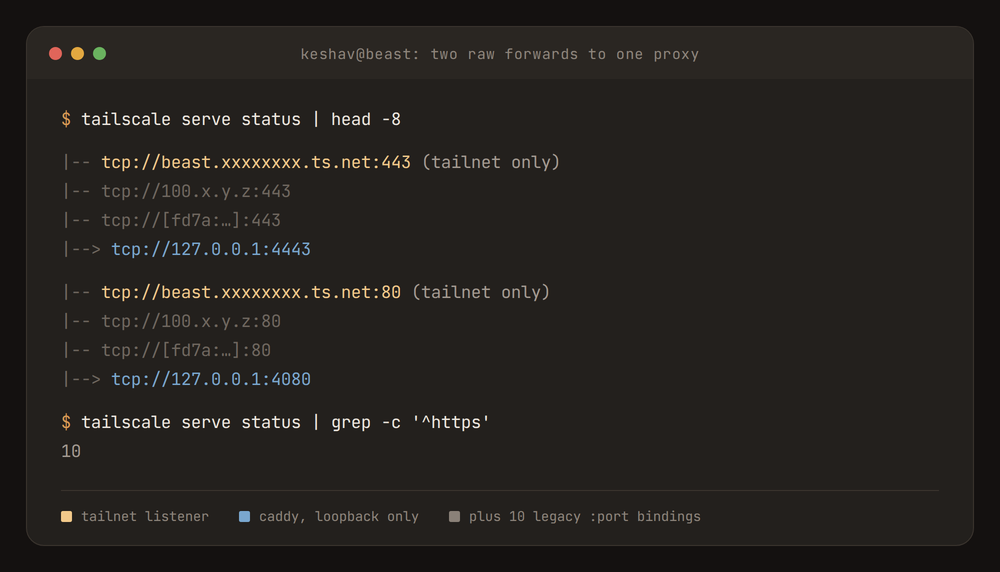
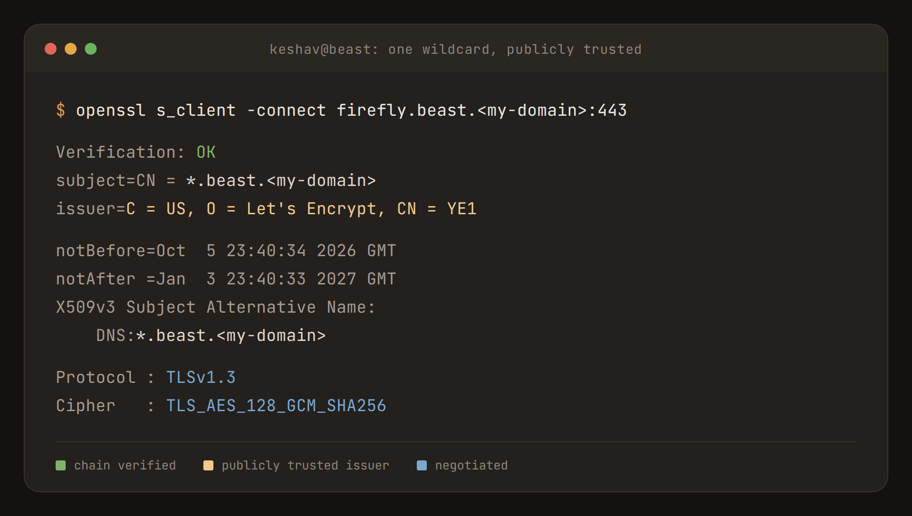
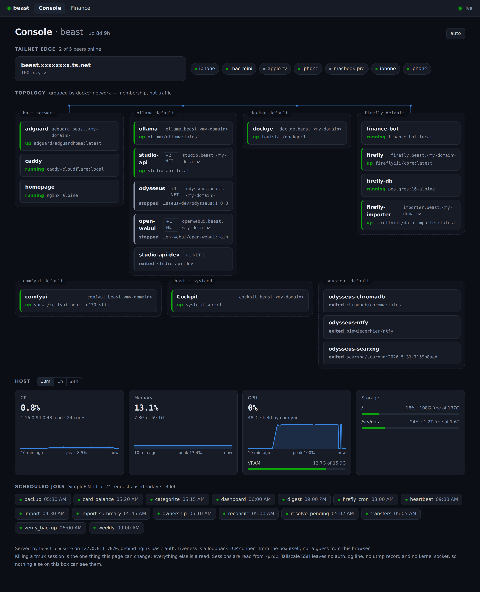
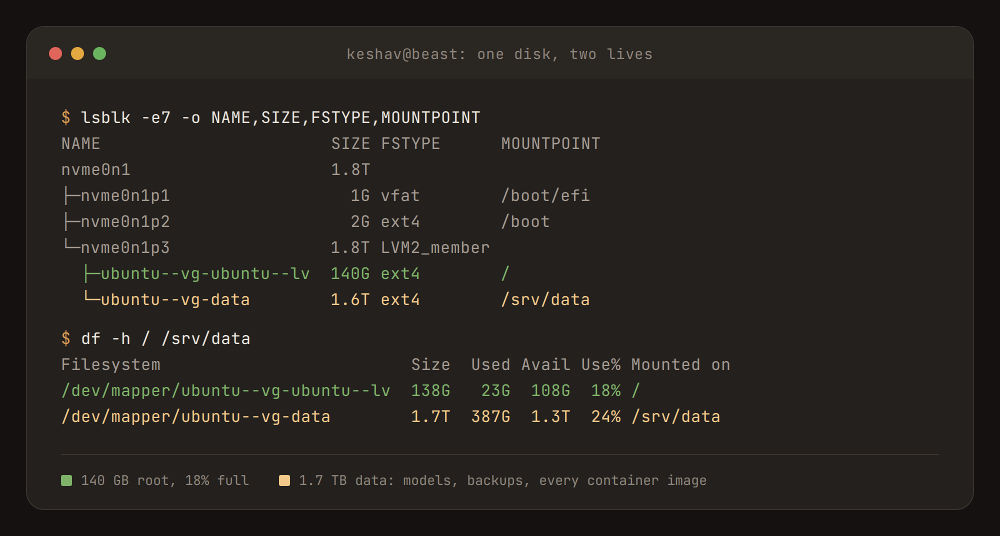

import Diagram from "../../../components/Diagram.astro";

**beast** is a home server I built to run my own AI models, finance system and files instead of renting cloud machines. It has no monitor or keyboard; I manage it entirely from my phone and laptop.

Ryzen 9 9900X, RTX 5070 Ti (16 GB), 2 TB Gen5 NVMe, Ubuntu.



<Diagram variant="grid" title="What it does">

- **Local AI.** Open-source models on my own GPU, with an OpenAI-compatible API.
- **Images and video.** ComfyUI, driven by studio, an app I built.
- **Coding agents.** Claude Code sessions that live on the box, so I can pick them up from my phone.
- **Finance.** Firefly III and [finance-bot](/finance-bot/).
- **Storage.** 1.7 TB shared to my Mac over Samba.
- **Ad blocking.** DNS filtering for all my devices.

</Diagram>

## Deploying Something

Every service is a Docker Compose stack managed in Dockge. To add one, I paste a compose file, deploy it, and add a few lines to the Caddy config. It's then live at `https://<service>.beast.<my-domain>` with a valid certificate. No cloud account, no monthly bill.

| Service | What it's for |
|---|---|
| Ollama | Local model serving |
| ComfyUI | Image and video generation |
| studio | My chat app that drives ComfyUI |
| Open WebUI | Plain chat UI for local models |
| Firefly III | Finance ledger |
| finance-bot | Automation around the ledger |
| Dockge | Stack management |
| Cockpit | System admin |
| AdGuard Home | DNS ad blocking |
| Caddy | Reverse proxy and TLS |

## AI

Ollama serves local models on the GPU and ComfyUI handles image and video generation. studio is a web app I built on top of both: I chat with a local model or with Claude, and it generates images and video through ComfyUI. Nothing I type leaves the house.

finance-bot also uses a model each night to categorise the transactions its rules don't recognise.

## From My Phone

Claude Code runs as a service on the box, so I can start a session on my laptop and continue it in the Claude iOS app. For everything else I SSH in over Tailscale and work in persistent `tmux` sessions, so a dropped connection doesn't kill anything.

## Networking

Nothing is exposed to the internet. Every service is reachable only over Tailscale, a WireGuard mesh where each device is individually authorized.

Each service has its own hostname under a wildcard domain. Tailscale forwards ports 443 and 80 to Caddy, which handles TLS with a Let's Encrypt wildcard certificate. Because the certificate is real, native iOS apps like Abacus, a Firefly III client, work as well as browsers.





One thing to know if you run Docker behind `ufw`: Docker's published ports bypass the firewall, so `ufw deny` doesn't block them. Every container here binds to loopback only, and only Caddy is reachable through Tailscale.

```yaml
ports:
  - "127.0.0.1:8080:8080"
```

AdGuard Home is the DNS server for every device on my tailnet, so ads and trackers are blocked at home and on cellular. beast is also a Tailscale exit node, so I can route traffic through home when I'm on public Wi-Fi.

## Console

The main hostname opens a live console showing every container and its status, CPU, memory, GPU and disk usage, and the finance jobs.



## Storage

The OS and data are on separate LVM volumes, 140 GB for root and 1.7 TB for data, so a large download can't fill the OS disk. Docker images live on the data volume too. With the containerd image store, that meant moving containerd's root as well as Docker's. The data volume is shared to my Mac over Samba.



## Monitoring

- **beast-sentry** sends a Telegram alert when something unusual happens, like an unknown device, a new open port or an unexpected process on the GPU, and can power the machine off from the alert. Routine activity goes into a daily digest.
- **netwatch** checks the network every minute and fixes it step by step if it drops: renew the lease, restart Wi-Fi, reload the driver, restart Tailscale, and reboot as a last resort.

## Setup

The whole machine is set up by numbered, idempotent shell scripts, so rebuilding it or re-running any step is safe.
